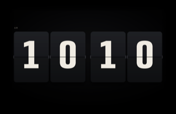
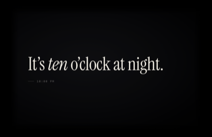
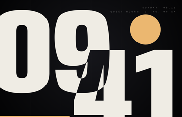
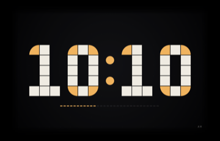

# Quiet Hours

A free, open source macOS screensaver with calm clock styles. It follows your Mac's light or
dark mode and your 12/24-hour setting automatically.

**Status:** early development. All eight styles work: Hinge (split-flap), Chorus (24 clocks),
Breath (variable type), Lumen (points of light), Prose (the time as a sentence), Slice (ribboned
numerals), Poster (Swiss poster type) and Module (Bauhaus tiles).

   

## Download and install

1. Download **QuietHours-<version>.zip** from the [latest release](../../releases/latest) and open it.
2. Double-click the screensaver you want, for example **Quiet Hours – Hinge.saver**, and choose
   whether to install it for you or for all users.
3. Pick it in **System Settings → Screen Saver** (under "Other"). Each style is its own tile, so
   install as many as you like.

**Options…** sets the finish (Auto follows light/dark mode), 12/24-hour time, seconds and Pure
black (on by default, best for OLED screens). Works on macOS 12 Monterey and later, on Apple
Silicon and Intel. To remove one, right-click it in Screen Saver settings and choose Delete.

## Windows (experimental)

There is an early Windows version of all eight styles, built from the same designs. It is not
released yet, and it hasn't been tested on a Windows PC. To help test it, see
[windows/README.md → For testers](windows/README.md#for-testers).

**Expect a warning.** The Windows builds aren't code-signed yet, because signing needs a paid
certificate. When you open one, Windows may show **"Windows protected your PC"**. Click
**More info**, then **Run anyway**. Nothing is wrong with the file: Windows shows this for any
program from a publisher it doesn't know yet. On Windows 11 with **Smart App Control** turned on,
unsigned programs are blocked and there is no "Run anyway". Wait for a signed release rather than
turning Smart App Control off. The source is all here if you'd rather build it yourself.

## Privacy

Quiet Hours collects nothing. There are no analytics, no accounts and no ads, and it never
connects to the internet. It shows the time from your own computer's clock. Your options are
saved only on your computer: in each screensaver's preferences on a Mac, and in the registry
under `HKEY_CURRENT_USER\Software\Quiet Hours` on Windows.

## Build from source

Requires Xcode and [XcodeGen](https://github.com/yonaskolb/XcodeGen) (the script installs it
with Homebrew if it's missing).

```bash
scripts/install-local.sh --open
```

`scripts/install-local.sh` builds and installs all eight savers, one per style. Pick **Quiet Hours – Hinge**, **– Chorus**, **– Breath**,
**– Lumen**, **– Prose**, **– Slice**, **– Poster** or **– Module** in System Settings → Screen Saver (under Other; quit and reopen System
Settings if they don't show up yet). **Options…** sets the finish (Auto follows light/dark mode),
12/24-hour time and seconds. To remove them all:

```bash
scripts/install-local.sh --uninstall
```

Supports macOS 12 Monterey and later on Apple Silicon and Intel.

## Making a release

```bash
scripts/package-release.sh   # → dist/QuietHours-<version>.zip (+ .sha256)
```

It signs with a *Developer ID Application* certificate and notarizes with Apple when they are set
up (see the script's header); without them it produces a local test build that only this Mac
accepts. Attach the zip to a GitHub Release.

## License

MIT (see `LICENSE`). Bundled fonts, both under the SIL Open Font License 1.1: Anybody © The
Anybody Project Authors (`Resources/Fonts/OFL-Anybody.txt`) and Instrument Serif © The Instrument
Serif Project Authors (`Resources/Fonts/OFL-InstrumentSerif.txt`).
